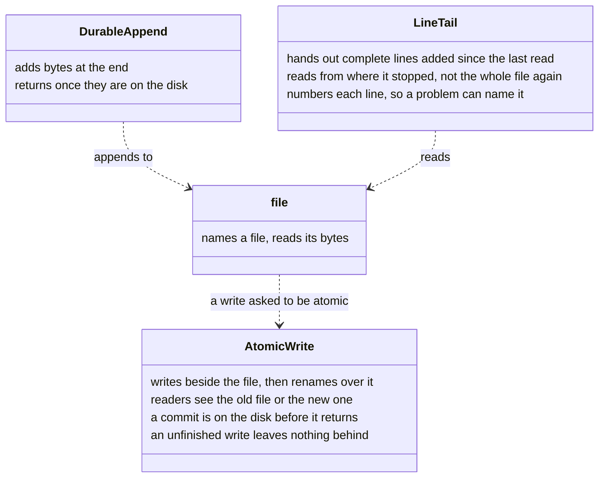
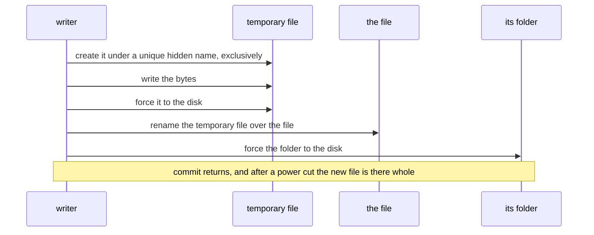

# pathlike: writes that survive

Status: settled 2026-09-23; the atomic write built 2026-10-19 (below), the durable append and the
line tail not yet · Owner: Debith

How pathlike replaces a file so that a reader never sees half of it and a power cut never leaves a
record pointing at nothing, how an append knows its bytes reached the disk, and how a reader takes
only the complete lines of a file another process is still appending to. The callers in mind are
stores that keep their records as files, and anything that rewrites a file other processes read.

## Scenarios

| Scenario | What must hold |
|---|---|
| A reader opens `records/x.md` while it is being rewritten | it reads the old text or the new, never a mix |
| The power goes out just after a store appended a row | the content object the row names is on the disk, whole |
| Two processes write one file at once, neither holding a lock | each writes its own temporary file; the file ends as one of them, whole |
| A write throws halfway | the old file is untouched, and no temporary file is left behind |
| A session reads a log another process is appending to | it gets complete lines only, numbered; a half-written last line is held back, and a later read returns it once it is complete |

## The classes

Each class says what it is responsible for; the arrows follow
[the relationship pattern](plantuml_relationship_pattern.md).

A caller does not reach for `AtomicWrite` by name: it asks `file` for an atomic write, and
`file` hands the bytes to an `AtomicWrite` (see *In Python* for why it is an option, not a
method). `AtomicWrite` is a class of its own because it owns something `file` does not: a
temporary file, from its creation to its rename or its removal.

`LineTail` is for a reader of logs that other processes append to, which otherwise reads each file
whole on every call and cannot tell a line still being written from a broken one.

## One write, step by step

| Step | What goes wrong without it |
|---|---|
| a unique name, created exclusively | two writers share one temporary file and interleave |
| force the file before the rename | the rename can reach the disk before the bytes do: a file that exists and is empty |
| the rename | a reader sees a half-written file |
| force the folder | the rename itself can be lost, and the old file comes back |
| remove the temporary file when the write does not commit | a throw leaves `*.tmp` in a folder that git commits |

## Before

pathlike's own `file::write_bytes` truncates and writes in place, as pathlib's does. It stays, for
parity; the new methods sit beside it.

## Built (2026-10-19)

The atomic write (Debith, 2026-10-19: "Go ahead"):

| Piece | Where | As designed, or what changed |
|---|---|---|
| `AtomicWrite` | `basic_atomic_write<File, Sync>` in `pathlike/core.h`, `atomic_write` for `file` | named as pathlike's other C++ types are (`basic_file`, `file_error`); `write(part)`, `commit()`, a destructor that removes an uncommitted temporary, and `temporary()` for a writer that writes by path |
| the temporary | `.<name>.<16 hex digits>.tmp` beside the file, created with `O_CREAT|O_EXCL` (`_wsopen_s` with `_O_EXCL` on Windows), retried on the 1-in-2^64 clash | as designed |
| forcing | `disk_sync`, the `Sync` policy: `fsync` (`F_FULLFSYNC` on macOS, `_commit` on Windows) before the rename, the folder's `fsync` after it; a file system that cannot force a folder (EINVAL, ENOTSUP) is let be, since the rename has been made | as designed; the recording policy for tests is not built yet |
| the option | `write_bytes(data, write_mode::atomic)` in C++; `path.write(obj, atomic=True)` and `path.write_bytes(data, atomic=True)`, keyword-only, off by default | as designed; the name is `atomic` |
| an engine's write | the engine writes `temporary()` by its path, and `commit()` renames it | the engines and their concept are unchanged: each renders text and writes a file |
| `unlink(missing_ok=False)` | `file::unlink`, `path.unlink` | not in the design; pathlib's, added with the atomic write so a caller can remove a file it keeps |

Decided with this implementation, as the Open table asked: the old file's permission bits are
carried over (best effort; the owner cannot be), and a symbolic link is written through — the file
it names is replaced and the link stays. Two rows of the difference table below changed with that.

No caller in this repository asks for it yet: `pygim/_stubs.py` still writes the stub file in place.

Tested (`tests/unittests/test_pathlike.py`): the file is a new one after an atomic write and keeps
its permission bits; a missing file is created; a failing engine write leaves the file and no
temporary; a symlink is written through; `write_bytes` takes the option; a plain write stays in
place. Not tested by a unit test: the forcing itself, since a power cut cannot be caused there; its
order was checked by reading, not traced (no `strace` on the machine it was built on).

## What holds it

1. **One primitive, asked for by an option.** `f.write_bytes(bytes, write_mode::atomic)`: an enum
   rather than a `bool`, so the call site says what it asks for. Behind it is `AtomicWrite`, which
   C++ may also use directly to write in pieces — `AtomicWrite w(f); w.write(part); w.commit();`
   — and which removes its temporary file when destroyed without `commit()`. Appends go through
   `DurableAppend`.
2. **Tests that state the guarantees.** Each row of the scenario table is a test. The power cut
   cannot be caused in a unit test, but the order that survives one can be checked: how bytes
   are forced to the disk is a policy (a template parameter), and a recording policy in tests
   writes down each write, force and rename.

## In Python

`path.write(obj, atomic=True)` and `path.write_bytes(data, atomic=True)`: an option on the two
writes `pygim.path` already has, not new methods (Debith, 2026-09-23, on the first draft's
`write_atomically`: "why not just path.write(ensure_atomic=True)?"). It is the same operation with
a stronger guarantee, and a name per guarantee would split one job across methods — the reason
pygim prefers an option to a near-duplicate command. The option also reaches `write`, which
serialises a value through an engine and is where most writes of structured data belong: a
configuration, a document a program keeps. The first draft listed byte methods only and left it
out.

The option is keyword-only and off by default, as pathlib's writes are in place. An atomic write
makes a new file and renames it over the old one, and the difference is visible:

| | In place — the default, as pathlib | `atomic=True` |
|---|---|---|
| a symbolic link at the path | written through, to its target | written through: its target is replaced (2026-10-19) |
| a second hard link to the file | sees the new contents | keeps the old file |
| the file's permissions and owner | kept | the permission bits carried over (2026-10-19); the owner the writer's |
| permission needed | to write the file | to write its folder |
| a FIFO or a device, such as `/dev/stdout` | written | cannot be renamed over |

Its docstring states the whole guarantee: a reader sees the old contents or the new, and after a
power cut one of them is there whole.

Two things are not in Python yet, and their absence is sequencing rather than a decision against
them. A way to write in pieces is not there because `pygim.path` has no `open()` and every caller
so far writes a whole value — the C++ `AtomicWrite` already streams. A durable append is not
there because nothing in Python appends. When a caller needs either, it takes the same shape: an
option on a write, not a new name. The name `replace` is never used for this: pathlib's
`Path.replace(target)` means rename, `pygim.path` keeps pathlib's meanings, and an atomic write
under that name would give it a second one.

The first Python caller writes in place today: `pygim/_stubs.py` writes the stub file.

## Open

| Question | How it will be found out |
|---|---|
| On Windows a file another process has open cannot be replaced, the rename call to use differs (`MoveFileExW` or `ReplaceFileW`), and a folder is not forced to disk the same way | a run on Windows, in CI |
| Who removes a temporary file that a killed process left, since a kill runs no destructor | the names are recognisable (`.<name>.<16 hex digits>.tmp`, 2026-10-19), so whoever opens the folder can remove old ones; nothing removes them yet |
